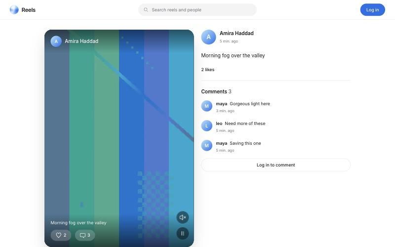

# Reels

A short-form vertical video app: scroll a snap-to-video feed, like and comment, post your own clips and follow along on profiles. Built with **Next.js 16** (App Router, Server Components, Server Actions, Cache Components) on a self-hosted **PocketBase** backend.



## Features

- **Vertical feed** with scroll snapping and infinite loading. Videos play when they're on screen and pause when they leave.
- **Likes** with optimistic UI (`useOptimistic`), backed by a unique index so a like can't be counted twice.
- **Comments**, **likes list**, **activity** (who liked your reels) and **search** across captions, names and usernames.
- **Uploads** for MP4/WebM/MOV, validated on the client, the server and in the database schema.
- **Profiles** with avatar, display name and bio.
- **Accessible**: labelled controls, keyboard support, `aria-pressed` likes, and less motion when `prefers-reduced-motion` is set.

## Architecture

```
Browser ──► Next.js (RSC + Server Actions) ──► PocketBase (SQLite, auth, file storage)
              │
              ├─ lib/pocketbase/server.ts   per-request client, session from an httpOnly cookie
              ├─ lib/data.ts                read queries (server-only)
              ├─ lib/actions/*              mutations + "load more" (Server Actions)
              └─ lib/validation.ts          Zod schemas shared by forms and actions
```

**Pages render on the server.** Each route streams its data inside a `<Suspense>` boundary, so the static shell (navbar, layout) is prerendered and served instantly while the dynamic parts stream in. Client components only handle interaction: the video player, infinite lists, optimistic likes and forms.

**Auth stays on the server.** Login and signup are Server Actions. The PocketBase token is stored in an `httpOnly`, `SameSite=Lax` cookie that JavaScript can't read. On each request a fresh PocketBase client is created and the token is confirmed with PocketBase (`authRefresh`) before anything trusts it, so a hand-crafted cookie is never treated as a login. Clients are never shared between requests.

**Defence in depth.** Every Server Action validates its input with Zod, and every user value reaches PocketBase through bound filter parameters (`pb.filter('caption ~ {:q}', { q })`), never through string concatenation. Even so, the database is the final authority. The [migration](pocketbase/pb_migrations/1732700000_init_schema.js) defines access rules so that:

| Collection | Read | Create | Update / delete |
|---|---|---|---|
| `users` | public profile; email stays private | sign-up | only yourself |
| `posts` | public | signed in, as yourself | only the author; the author can't be changed |
| `likes` | public | signed in, as yourself; one per post | delete only your own; immutable |
| `comments` | public | signed in, as yourself | only the author |

Like and comment counts come from a SQL **view collection** (`post_stats`). A page of the feed costs three queries in total, not three per post.

## Getting started

Requirements: Node.js 20+, and `ffmpeg` if you want demo videos.

```bash
# 1. Install
npm install
cp .env.example .env

# 2. Download PocketBase (v0.40+) for your platform into .pocketbase/
#    https://pocketbase.io/docs/  e.g. macOS arm64:
mkdir -p .pocketbase && cd .pocketbase
curl -LO https://github.com/pocketbase/pocketbase/releases/download/v0.40.6/pocketbase_0.40.6_darwin_arm64.zip
unzip pocketbase_*.zip pocketbase && rm pocketbase_*.zip && cd ..

# 3. Start PocketBase; migrations in pocketbase/pb_migrations apply automatically
npm run pb

# 4. In a second terminal: seed demo users, reels, likes and comments
npm run seed

# 5. Start the app
npm run dev
```

Open http://localhost:3000 and log in as `maya`, `leo` or `amira` (the seed script prints the demo password). The PocketBase dashboard runs at http://127.0.0.1:8090/_/.

## Scripts

| Script | What it does |
|---|---|
| `npm run dev` | Next.js dev server (Turbopack) |
| `npm run build` / `start` | Production build / server |
| `npm run lint` | ESLint (`next/core-web-vitals` + TypeScript rules) |
| `npm run typecheck` | `tsc --noEmit` in strict mode |
| `npm run pb` | Local PocketBase with this repo's migrations |
| `npm run seed` | Demo data through the public API (so the seed also exercises the access rules) |

## Project structure

```
app/                     routes (App Router)
  (auth)/login, signup   auth screens, redirect away when signed in
  posts/[id]/            reel + comments, likes list
  profile/[username]/    profile header + that user's reels
  search, activity, create, settings/profile
components/              UI, grouped by feature (feed, comments, profile, …)
hooks/                   useInfiniteList, useInView
lib/                     PocketBase client, data access, Server Actions, validation
pocketbase/pb_migrations schema and access rules as code
scripts/seed.mjs         demo data
```

## License

[Apache 2.0](LICENSE)
